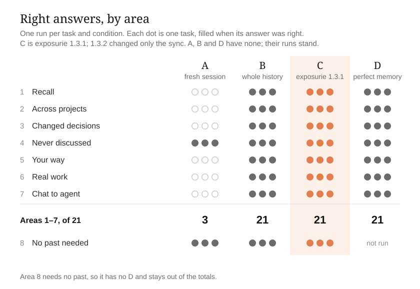
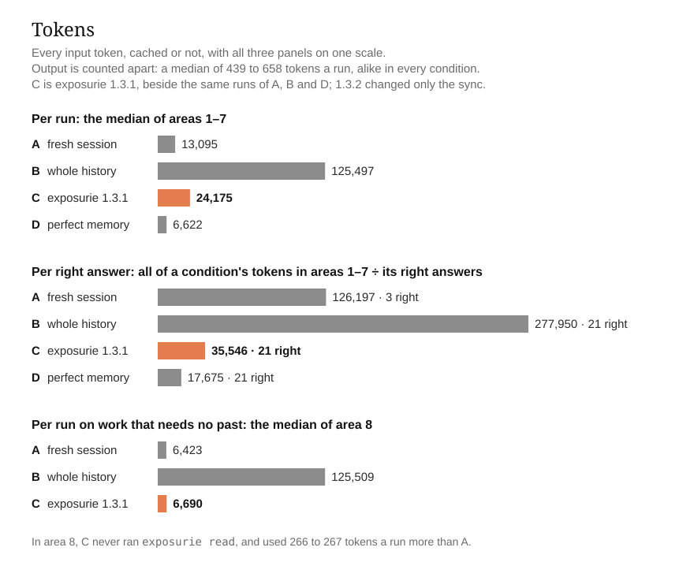
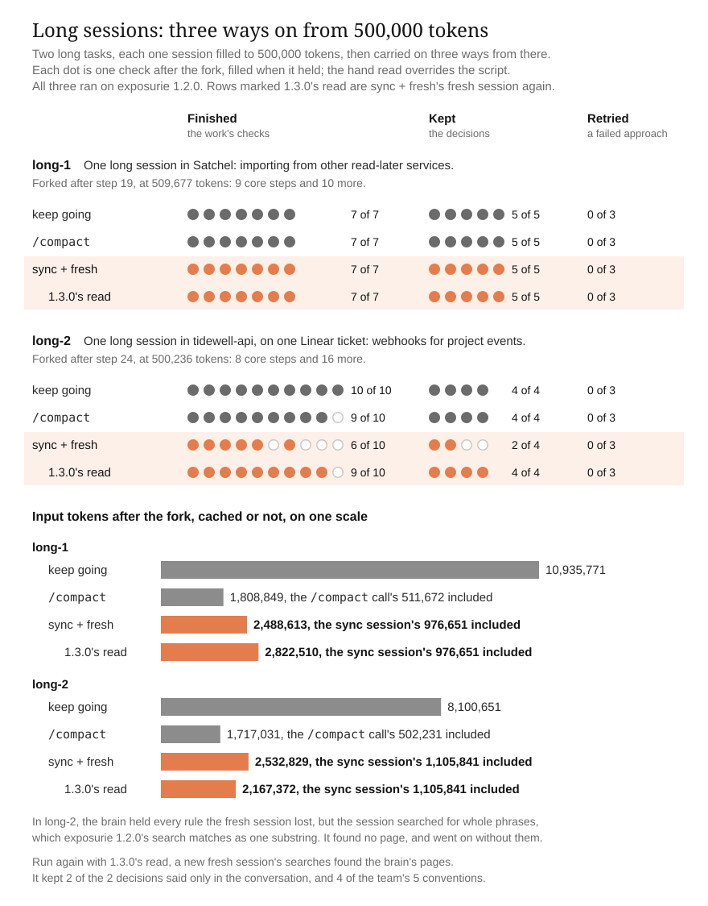

# exposurie-bench

Does an external brain make a coding agent better for the person using it? This repository measures that for [exposurie](https://github.com/sekhonlabs/exposurie). exposurie is a CLI that builds a curated Markdown wiki (the brain) from a person's own agent sessions and chat exports, and points every new session at it.

**Status: all nine areas and part 13 are run, scored and checked by hand, and the results lead with exposurie 1.3.1, the version on npm.** Two made-up users, a developer and someone who hands everything to agents, have 53 generated sessions of history between them, and an exposurie brain was built from each. Everything ran first with exposurie 1.2.0, on Claude Code 2.1.302 with Sonnet 5.5. Condition C then ran again on the same brains with each newer release: 1.3.0's read, then 1.3.1. A, B and D have no exposurie, so their runs stand. [How C got here](#how-c-got-here) keeps every version's results, and [docs/build-plan.md](docs/build-plan.md) says how it was built, part by part.

## The question

Same tasks, same model, same tools. Does a fresh session with an exposurie brain:

1. get the user's past right more often than a session without one,
2. spend fewer tokens than the way people keep context today (one long session, or pasting history back in),
3. cost almost nothing extra on work that needs no past,
4. and say "not recorded" instead of inventing an answer?

## Four conditions

| | Condition | Stands for |
|---|---|---|
| A | Fresh session | what every new session gets today |
| B | Whole history in context | the long-session habit |
| C | exposurie | fresh session + pointer + brain |
| D | Perfect memory | only the facts the task needs, pasted in |

The questions are spread across nine areas, from recall to long sessions, with three tasks in each of the first eight and two in the last: about 105 runs. Part 13 then gives one job to several agents, with the brain as their shared memory. See [docs/design.md](docs/design.md).

## Results: areas 1 to 8, with exposurie 1.3.1

The four questions, answered:

1. **Right more often than a fresh session:** 21 of 21 against 3.
2. **Fewer tokens than the whole history:** a median of 24,175 a run against 125,497.
3. **Almost nothing extra on work that needs no past:** about 313 tokens a run more than a fresh session, like for like.
4. **"Not recorded" instead of inventing:** no made-up answers, in any condition.

C's 24 runs are `full-3`, one for each task of areas 1 to 8, run on 2026-11-05. A's, B's and D's are the full run's of 2026-10-21, one run per task and condition. Every verdict is final: of C's 24, 13 were settled by a task's checks and 11 by the judge and then by hand, and the hand read overturned none. Tokens are every input token, cached or not; output is few and alike in every condition, a median of 439 to 658 tokens a run. Every number here is computed from [results/](results/) alone by [score/results.mjs](score/results.mjs), and they are all in [results/numbers.json](results/numbers.json), under `pointer_for_work`.

Before each C run, two things were set up the same way, and [docs/decisions.md](docs/decisions.md#2026-11-05) gives the reasons:

- **The run's home was brought up to 1.3.1 by exposurie's own update step.** The brains were set up by 1.2.0, and the first 1.3.1 command on such a machine rewrites the pointer, skill and command exposurie wrote outside the brain. The brain itself is not touched. This is what a person who updates from 1.2.0 has after their first command.
- **The run's copy of the brain was made 3 days old,** so exposurie's state line read `last sync 3d ago`, with no line asking the agent to sync. The brains were last synced on 2026-10-21. Every page is the same.

- **Right answers, areas 1 to 7, of 21:** A 3, B 21, **C 21**, D 21. All three of A's are in area 4, where the right answer is that nothing was recorded.
- **Made-up answers** (area 4): none, in any condition.
- **Looked vs found:** C ran `exposurie read` in all 21 runs of areas 1 to 7, and was right in all 21. None of area 8's three opened the brain: they are work that needs no past, in an empty folder.
- **Stability:** area 3 under C ran once per task here, right in 3 of 3. With 1.2.0 and with 1.3.0's read it ran three times per task, and was right in 9 of 9 both times.

- **Tokens per run**, median of areas 1 to 7: A 13,095, B 125,497, **C 24,175**, D 6,622. By the median, C used about 13% of B's tokens on a question (16,796 against 125,495), and about 10% on a work task (76,063 against 736,844).
- **Tokens per right answer:** A 126,197, B 277,950, **C 35,546**, D 17,675.
- **On work that needs no past** (area 8): C never ran `exposurie read`, and used 267 tokens a run more than A as measured, about 313 like for like. 1.3.1's pointer is about 15 tokens longer than 1.2.0's, whose runs used 298 more than A's. During this batch the sandbox's Claude Code also rewrote its own state file, so every later run started 46 tokens smaller than A's runs of 2026-10-21. B used 125,509, because it carries the whole history every time.

**Dropped on 2026-10-28** (see [decisions.md](docs/decisions.md#2026-10-28)):

- *Potential reached*, (C − A) ÷ (D − A). It only restated the right-answer count, since B and D got every answer right.
- *Break-even*, the sessions until a brain's build tokens are saved back against B. Its answer swung tenfold with the unit (for the developer's questions, 44 sessions in input tokens and 4 in list-price dollars), and a brain is built on a plan its owner already pays for. Each build's tokens stay in [results/builds.json](results/builds.json).

**Against what [design.md](docs/design.md#what-we-expect-written-before-the-results) expected before any result:** C beat A by a wide margin, and used more raw tokens (24,175 against 13,095 a run). B was expected to be more accurate than C with a history this short: with 1.2.0 it was, 21 against 18, and with 1.3.1 C matches it. Changed decisions lost no detail: area 3 under C was right in every run of every version.

**What this does not show:** one run per cell, so a count per area is only indicative; one agent and one model; two made-up users; and histories small enough for B to fit in context, which a real history would not. 1.3.0's search and 1.3.1's pointer were each made after a miss on these same tasks, so these tasks shaped them; part 13's tasks did not. See [design.md](docs/design.md#limits).

## Results: many agents, one job (part 13)

Someone running several agents in parallel on one job, with the brain as their shared memory. While agents work side by side, none hears what the others are told.

- **Round 1:** three agents built the import of Satchel, the developer's own app, in condition C on exposurie 1.3.1, each in its own copy of the code: the job, a Pocket reader, and the import page with its summary email. In conversation, each was also told decisions for the work that came next, and not to build them.
- **Their copies** were merged with Git's union merge, tested, and synced into the developer's brain.
- **Round 2:** three new agents in each condition built Instapaper's reader, Omnivore's reader and imported highlights, blind, from one short ask each. Each needed decisions told to two different agents of round 1, and the highlights' shape was needed by all three.

The conditions differ only in what carries round 1's conversations into round 2. See [docs/build-plan.md](docs/build-plan.md), part 13.

**By hand, round 2's merged work kept 0 of round 1's 6 decisions with no memory, 5 with exposurie 1.3.1, and 6 with a perfect notes file.**

| What carried round 1's conversations | A, nothing | C, exposurie 1.3.1 | D, a perfect notes file |
|---|---|---|---|
| Decisions the merged work kept, of 6, by hand | 0 | **5** | 6 |
| …by the scorer, before the hand read | 0 | 2 | 5 |
| The three agreed on the highlights' shape | no | no | yes |
| Agents that opened the brain | no brain | 3 of 3 | no brain |
| Commit messages in the developer's style | 1 of 3 | 3 of 3 | 3 of 3 |
| The repository's own tests after the merge | 79 of 79 | 90 of 92 | 82 of 84 |
| Input tokens in round 2 | 636,942 | 866,701 | 562,370 |

- **The sync filed all six decisions,** into a page of their own. Round 1 wrote none of them into its code, so in round 2 they were said only in conversation.
- **C's one miss was not the brain's.** Its Instapaper agent searched the brain, read the page that holds the highlights' shape, and left Instapaper's highlights out: "Highlights belong to the other agent's side." Its ask gave the third agent "the highlights side", and the page words that decision as a plan ("readers will put highlights"). D's notes word it as a rule, and D's Instapaper agent followed it. The brain carried every decision; its wording decided whether one was acted on.
- **Round 1's merge collided.** The job agent and the page agent both wrote the upload route, and both added a test file of the same name, so the union merge declared everything twice and the code did not load. It was repaired by hand, 9 lines in and 41 out, with nothing of round 2 in it: [results/team-1/repair-1.patch](results/team-1/repair-1.patch). That is a finding about parallel agents, not about exposurie.
- **The hand read overturned the scorer where the scorer was wrong,** in four ways, each recorded in [hand.json](results/team-1/hand.json):
  - a hidden test expected more than its decision said
  - a check missed a threshold written as a named constant
  - two tests could reach the third agent's code only through Instapaper's export
  - a check found a commit prefix anywhere in the last reply

  The hand tests it rests on are published beside it.
- **Cost:** about $3.26 in Claude Code's estimates at list prices: $1.14 for round 1, $0.29 for the sync, and $0.58, $0.70 and $0.54 for round 2 in A, C and D. The plan's seven-day meter read 5% after the first step and 9% after the last run.

The scores, which run had which condition, the hand read with a reason for every verdict, its hand tests and round 1's repair are in [results/team-1/](results/team-1/), and the numbers in [results/numbers.json](results/numbers.json) under `many_agents`.

**What this does not show:** one job, one user and one run per cell; round 1 ran once, in C, and was repaired by hand; the agents could not run tests, which ran after each merge; one sync, so exposurie's missing lock, where two syncs at once take the same batch, never came up; and the decisions were written for this test.

## Results: area 9, the long sessions

**Run with exposurie 1.2.0, and sync + fresh's fresh session again with 1.3.0's read. Area 9 has not run on 1.3.1.**

A common rule of thumb says to start a fresh session at half the context window, with the brain synced first. Area 9 tests it with two long tasks, both the developer's. Each is one session, filled live to the first step boundary past 500,000 tokens of Sonnet 5.5's 1,000,000. Each is then carried on three ways from that same point:

- **keep going** in the same session
- **`/compact`**, Claude Code's own summary
- **sync + fresh:** end the session, sync it into the brain from another session five minutes later, and start a fresh one

Every strategy then gets the same steps, which finish the work. See [design.md](docs/design.md#area-9-long-sessions).

- **long-1** is the developer's own app, Satchel: imports from Pocket, Instapaper and Omnivore. It forked after step 19, at 509,677 tokens.
- **long-2** is their work's API, tidewell-api: webhooks for project events, under one ticket, through an on-call week. It forked after step 24, at 500,236 tokens. The team's conventions for a pull request are never said in the session, so a strategy keeps them only by looking them up.

The chart's `1.3.0's read` rows are sync + fresh's fresh session again with 1.3.0's read ([below](#130s-read-2026-10-25)); everything else here is 1.2.0's.

- **keep going and `/compact` lost almost nothing.** Across both tasks, keep going held all 17 checks of the work and all 9 checks of the decisions. `/compact` held 16 and 9: its one miss was long-2's deploy note, which never named the team's deploys channel.
- **With 1.2.0, sync + fresh was exactly as good as the brain's search.** In long-1 it finished 7 of 7 and kept 5 of 5. In long-2 it finished 6 of 10 and kept 2 of 4:
  - It lost both decisions said only in the conversation. It put replaying a dead letter on the customer's own key, where the rule was the staff-only admin routes. It also made up its own retention, 14 and 30 days, where the rule was 45.
  - It missed four of the team's five conventions: the branch format, the four sections, the note for the migration's reviewer, and the deploy note.
  - The brain held every one of those rules: the sync filed the session's rules into a page of their own, and other pages held the team's conventions. But the fresh session searched once per step, with whole phrases such as `dead letter replay deliveries cleanup`.
  - exposurie 1.2.0's search matches a whole phrase as one substring, so each search found no page, and exposurie told the agent to say so rather than answer from memory. It is the same flaw as across-3's miss in areas 1 to 7, where a plural never found its singular.
- **With 1.3.0's read, long-2's sync + fresh is level with `/compact`:** 9 of 10 finished and 4 of 4 kept. See [below](#130s-read-2026-10-25).
- **No strategy retried an approach that had already failed:** 0 of 6 each.
- **Tokens after the fork**, every input token. keep going took 10,935,771 and 8,100,651, because every call re-reads the whole session. `/compact` took 1,808,849 and 1,717,031, and sync + fresh took 2,488,613 and 2,532,829. So keep going used 6.0 and 4.7 times `/compact`'s tokens, and 4.4 and 3.2 times those of sync + fresh. Those totals include the `/compact` call itself (511,672 and 502,231, one read of the session) and the sync session (976,651 and 1,105,841).
- **In money the gap is smaller,** because a cache read costs a twentieth of an uncached input token. long-2 ran with its cache warm throughout, and Claude Code's own estimates at list prices put its strategies at $1.68, $0.95 and $1.41. long-1 ran through two usage-limit stops, which let the cache expire. So keep going's first two steps, and the `/compact` call, each wrote the whole session into it again, and keep going came to $6.06.

The scores, the hand read with a reason for each verdict, and every step's record are in [results/area-9/](results/area-9/), and the numbers in [results/numbers.json](results/numbers.json) under `area_9`. After the forks, a usage limit stopped two attempts, both in long-1's keep going. Each ran again from the same point, so their 4,263,340 tokens are counted apart.

**Against what [design.md](docs/design.md#what-we-expect-written-before-the-results) expected before any result:** `/compact` beat sync + fresh within a single task, as expected: one missed check against six. Long sessions were expected to be where curation loses detail. Here it was retrieval that lost it: the brain held every rule, and the fresh session lost the ones its search did not find.

**What this does not show:** two tasks and one user, with one run of each strategy, so this is an illustration, not a rate. The sessions ended at about 580,000 tokens, too close to the mark to test whether quality falls past half the window. Area 9 cannot be scored blind, because a stream shows which strategy made it: every strategy was read by hand, and a verdict there overrides the scripts.

## How C got here

C ran three times on the same brains, with the same Claude Code, model, tools, audit and scoring, each time with a newer exposurie. A, B and D have no exposurie, so their runs stand, and every number sets C's runs beside them.

| | 1.2.0 | 1.3.0's read | 1.3.1 |
|---|---|---|---|
| Ran | 2026-10-21 | 2026-10-25 | 2026-11-05 |
| Right answers, areas 1 to 7, of 21 | 18 | 20 | **21** |
| Tokens per run, median of areas 1 to 7 | 34,494 | 19,551 | 24,175 |
| …of a question | 30,089 | 16,665 | 16,796 |
| …of a work task | 69,939 | 81,092 | 76,063 |
| Tokens per right answer | 49,263 | 35,526 | 35,546 |
| Looked, and right when it looked | 20 of 21, right in 18 | 20 of 21, right in 20 | **21 of 21, right in 21** |
| Area 8, runs that opened the brain | 0 of 3 | 0 of 3 | 0 of 3 |
| Area 8, tokens a run more than A | 298 | 299 | 267, about 313 like for like |
| Area 3 under C | 9 of 9 | 9 of 9 | 3 of 3, one run each |
| long-1, sync + fresh: finished, kept | 7 of 7, 5 of 5 | 7 of 7, 5 of 5 | not run |
| long-2, sync + fresh: finished, kept | 6 of 10, 2 of 4 | **9 of 10, 4 of 4** | not run |

### 1.2.0 (2026-10-21)

The published `@sekhon/exposurie` 1.2.0. All 93 runs of areas 1 to 8 ran in one mixed order on 2026-10-21, then the stability check's 6. Of the full run's 93, 54 verdicts were settled by a task's checks and 39 by hand, every answer the judge decided among them. Its numbers are at the top level of [results/numbers.json](results/numbers.json).

**C's three wrong answers**, each named by its run in [results/full/](results/full/):

- **recall-1** (`r049`) named SQLite, with the wrong reasons. The pilot's C run, on the same brain, gave the right ones.
- **across-3** (`r009`) searched for "google sheets", "sheets" and "spreadsheet", and named only the spending summary. The brain's page on the book club speaks of a "member Google Sheet", in the singular, and exposurie 1.2.0's search is a plain substring match, so a plural never finds its singular.
- **real-work-2** (`r003`) never ran `exposurie read`. Its pull request missed the team's branch format, `ENG-431-slug`, and its four sections.

### 1.3.0's read (2026-10-25)

1.2.0's results traced two of C's three misses in areas 1 to 7, and everything sync + fresh lost in long-2, to one flaw in its search: it matched the whole phrase as one substring. exposurie's `read` was rebuilt for it at commit [`b6855ee`](https://github.com/sekhonlabs/exposurie/commit/b6855ee30d876bb3f109088ccabb85450a0b2234). A search now takes its words in any order and any form, ranks the pages, and prints the best ones as written.

**Why its records say `1.2.0+b6855ee`:** its package still said 1.2.0 when it ran, so every run recorded 1.2.0 plus the commit. npm has served the same search, read and pointer as **1.3.0** since 2026-11-04, byte for byte, so this README and the charts call it 1.3.0's read. 1.3.0 also adds `exposurie update`, and after an update its first command says so once, which these runs never saw, so the records keep the label they recorded. See [docs/decisions.md](docs/decisions.md#2026-11-05).

Condition C ran again with it on 2026-10-25, on the same brains, with the same Claude Code, model, tools, audit and scoring. What exposurie installs, its pointer, skill and command, is the same text in both versions, so this C differs from 1.2.0's by the `exposurie` command alone.

- `full-2`: the 24 C runs of areas 1 to 8, once each, in a mixed order of their own.
- `stability-3` and `stability-4`: area 3 under C, twice more.
- `area-9-2`: sync + fresh's fresh session again in each long task, from the same fork and against the very brain its sync wrote. The sync session is not run again: the sync is the same code, and a second one would write another brain. Its record and tokens carry over.

Every judged answer was read by hand, though not blind, since every run here is C; the hand read overturned none of the 17. The numbers are in [results/numbers.json](results/numbers.json) under `rebuilt_read`.

- **Both search misses are right now.** recall-1 gave the recorded reason for SQLite (one file on one machine, with Litestream for backups), and across-3 named both projects on a Google Sheet.
- **The one miss left is real-work-2** (`r011` in [results/full-2/](results/full-2/)). Like 1.2.0's run, it never ran `exposurie read`, so its pull request again missed the team's branch format and its four sections. Nothing in the rebuilt read changes whether an agent looks.
- **Questions got cheaper and work tasks dearer.** A search now prints the best pages whole, so a run that looked made a median of 1.5 reads, against 5. A question's median run fell from 30,089 tokens to 16,665. A work task reads further, and its median rose from 69,939 to 81,092. Over areas 1 to 7, C's input fell from 886,737 tokens to 710,514. Area 8 is unchanged, within 2 tokens a run, because C never ran `exposurie read` there.
- **long-2's sync + fresh is now level with `/compact`:** 9 of 10 finished and 4 of 4 kept. Its fresh session searched for `ENG-447 webhooks project events`, found 34 pages, and read the one its sync had written about the session. It kept both decisions said only in the conversation: replays on the staff-only admin routes, and 45 days for every delivery. It also kept four of the team's five conventions, where 1.2.0's run kept one. It missed the deploy note's channel, as `/compact` did. The page that holds it matched only two of the eight words in the search for it, and was not among the 14 of 39 pages the search showed.
- **Tokens after the fork, sync session included:** long-2's sync + fresh took 2,167,372 against 2,532,829, and long-1's 2,822,510 against 2,488,613, since its fresh session read more of the brain. `/compact` took 1,717,031 and 1,808,849. In Claude Code's estimates at list prices, long-2's came to $1.31 against $1.41, and long-1's to $1.49 against $1.37.

**What this does not show:** the read was rebuilt after these results and measured on the same tasks. So it shows that the misses it was made for are fixed, not how its search does on questions that did not shape it. One run per cell again, and the hand read could not be blind.

### 1.3.1 (2026-11-05)

The one miss 1.3.0's read left was real-work-2, whose agent never opened the brain under either version. exposurie's pointer fired on questions about the user, and a plain ticket is not one. **1.3.1**, on npm since 2026-11-05 from commit [`64eb3f8`](https://github.com/sekhonlabs/exposurie/commit/64eb3f8c3a1d7686f14915c0f5f542ccd38e0a56), adds a condition for work: run `exposurie read --search "<topic or project>"` *before starting work in one of their projects*, as well as before answering a question about the user. Its search and read are 1.3.0's. Its runs are `full-3`, set up as [the results above](#results-areas-1-to-8-with-exposurie-131) describe.

- **real-work-2 is right now** (`r015` in [results/full-3/](results/full-3/)). Its agent ran `exposurie read` before starting, twice, and its PR.md gives the branch as `ENG-431-export-empty-org`, a title that opens with the ticket key, and the team's four sections: why, what changed, how it was tested, and how to roll it back.
- **The new line fires on the user's work and not on other work.** Every C run in areas 1 to 7 opened the brain. None of area 8's three did.
- **The cost per right answer is level, with one more right answer:** 35,546 tokens against 35,526. A question's median run is level too, and a work task's fell. Over areas 1 to 7, C's input came to 746,456 tokens against 710,514, most of it real-work-2 now reading the brain and doing the work the team's way. The median over areas 1 to 7 rose to 24,175 because two questions, across-2 and your-way-2, read a second page and so moved past the middle of the 21 runs. Both were right before and are right now.
- **Area 8's 267, explained.** The pointer is about 15 tokens longer, so it costs about 15 tokens more on every call: the batch's first two runs started 15 tokens above the same tasks' runs of 2026-10-21. During the second run, the sandbox's Claude Code rewrote its own state file, and among other things it refreshed its record of the account's model options. Every later run started 46 tokens smaller, though its start-up line was otherwise the same as part 10's. A's area 8 runs are from 2026-10-21, before that, so the pointer's cost like for like is about 313 tokens a run (298 plus 15), not 267. Every later run was about 46 tokens a call lighter for the same reason, which is too little to move any other row.
- **The measurement cost $1.00** in Claude Code's estimates at list prices: $0.93 for the runs and $0.07 for the judge.

**What this does not show:** 1.3.1's line was written after real-work-2's miss, and this measures it on the same tasks, so it shows the miss it was made for is fixed. Part 13's tasks did not shape it, and test it more fairly. One run per cell again, and the hand read could not be blind.

## What is here

| File | What it holds |
|---|---|
| [docs/design.md](docs/design.md) | the method, fixed before anything runs |
| [docs/build-plan.md](docs/build-plan.md) | the order it is built in, part by part, and what "done" means for each part |
| [docs/sources.md](docs/sources.md) | every paper and document cited, and what this benchmark takes from each |
| [docs/decisions.md](docs/decisions.md) | dated decisions and why |
| [CLAUDE.md](CLAUDE.md) | rules for any agent working in this repository, local or cloud |
| [users/](users/) | the two made-up users: who they are, every planted fact, and each session's brief |
| [tasks/index.json](tasks/index.json) | every task, by area, with its checks and the judge's rubric |
| [tasks/starters/](tasks/starters/) | the projects the work tasks and the long sessions start from |
| [tasks/conditions/](tasks/conditions/) | what conditions B and D put in the agent's instructions file: each user's whole history, and the facts each task needs |
| [tasks/long/](tasks/long/) | each long session of area 9: its steps, its checks, the material its steps hand over, and the script that writes them |
| [tasks/team/](tasks/team/) | part 13's team task: its steps and asks, the decisions, D's notes, the developer's exports, and the reference implementation the fake replays |
| [gen/](gen/) | the generator that writes each session from its brief, and the converter that turns the sessions into Claude Code transcripts and a claude.ai export |
| [check/](check/) | the checks that hold the fact sheets, the histories, the tasks, the runner and scorer, the brain build, the long sessions, the team task and the results to the method |
| [score/](score/) | how a task's checks read a run, the scorer, the judge for what the checks cannot settle, the long sessions' and the team task's scorers with its hidden tests, and the numbers and charts of the results |
| [runner/](runner/) | the run sandbox (pinned versions, setup, the environment every run gets, and its check), the runner and the brain build, the long sessions of area 9, the team task of part 13, and the fake `claude` they are tested against |
| [results/](results/) | scores saved from real runs (the pilot, the full run and the stability check) with which run had which condition, the brain builds' tokens, area 9's scores, hand read and record of every step, C again with 1.3.0's read (`full-2`, `stability-3`, `stability-4` and `area-9-2`) and with 1.3.1 (`full-3`), part 13's team task (`team-1`), every number in `numbers.json`, and the charts |

## License

MIT
