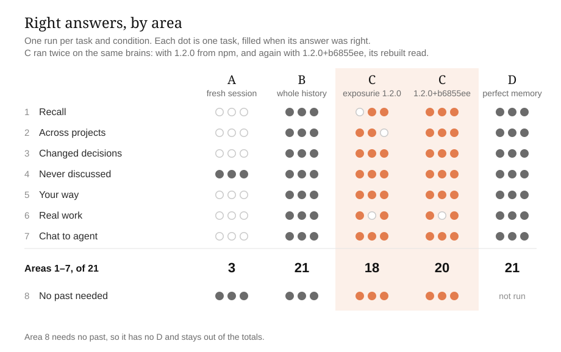
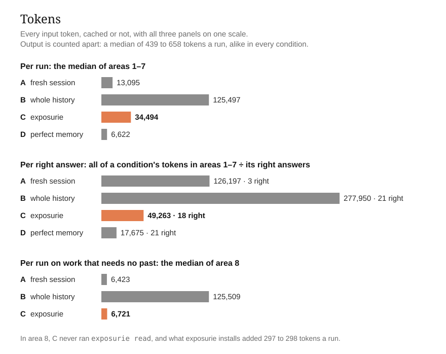
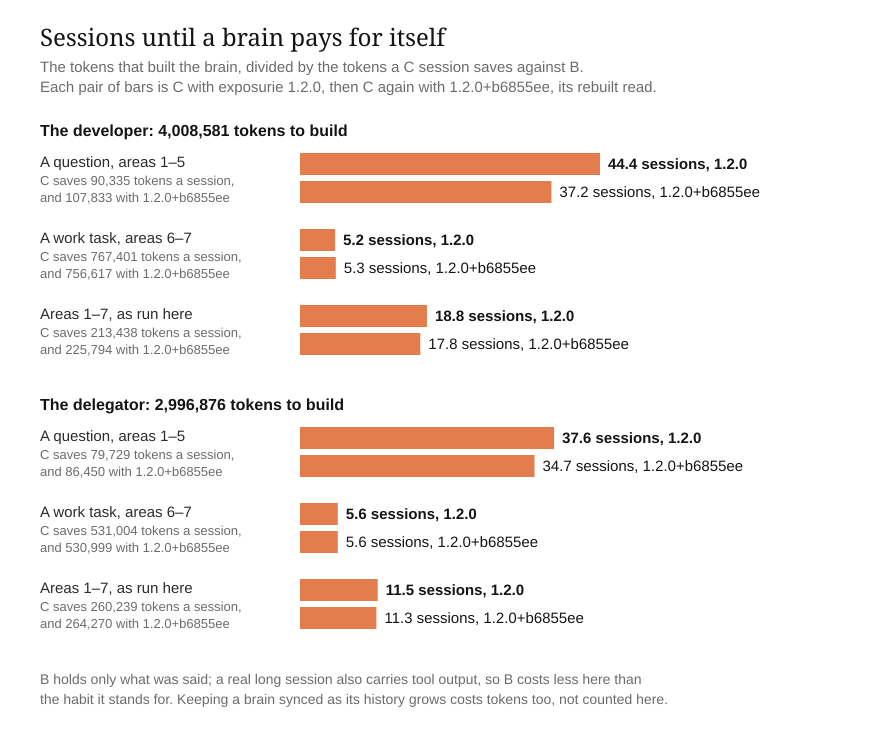
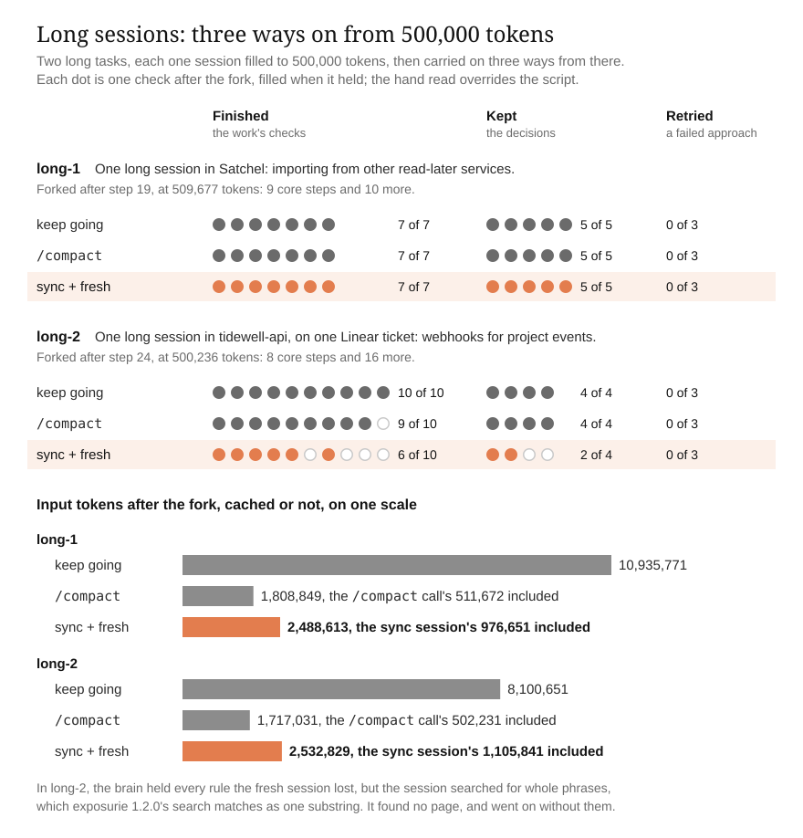

# exposurie-bench

Does an external brain make a coding agent better for the person using it? This repository measures that for [exposurie](https://github.com/sekhonlabs/exposurie). exposurie is a CLI that builds a curated Markdown wiki (the brain) from a person's own agent sessions and chat exports, and points every new session at it.

**Status: all nine areas are run, scored and checked by hand, and their results are below.** Two made-up users, a developer and someone who hands everything to agents, have 53 generated sessions of history between them, and an exposurie brain was built from each. All 93 runs of areas 1 to 8 ran in one mixed order, then the stability check's 6. Then area 9's two long sessions each ran once and were carried on three ways. How it was built, part by part, is in [docs/build-plan.md](docs/build-plan.md). It tests the published `@sekhon/exposurie` 1.2.0 with Claude Code 2.1.302 on Sonnet 5.5. Then C ran again with exposurie's read rebuilt, `1.2.0+b6855ee`, which is on GitHub and not yet on npm. Its results are [beside 1.2.0's](#c-again-with-exposuries-rebuilt-read), and 1.2.0's stay as they were.

## The question

Same tasks, same model, same tools. Does a fresh session with an exposurie brain:

1. get the user's past right more often than a session without one,
2. spend fewer tokens than the way people keep context today (one long session, or pasting history back in),
3. cost almost nothing extra on work that needs no past,
4. and say "not recorded" instead of inventing an answer?

## Four conditions

| | Condition | Stands for |
|---|---|---|
| A | Fresh session | what every new session gets today |
| B | Whole history in context | the long-session habit |
| C | exposurie | fresh session + pointer + brain |
| D | Perfect memory | only the facts the task needs, pasted in |

**Potential reached = (C − A) ÷ (D − A).** This is the share of the gap between a forgetful agent and a perfect-memory one that exposurie closes.

The questions are spread across nine areas, from recall to long sessions, with three tasks in each of the first eight and two in the last. That comes to about 105 runs. See [docs/design.md](docs/design.md).

## Results: areas 1 to 8

The four questions, answered:

1. **Right more often than a fresh session:** 18 of 21 against 3.
2. **Fewer tokens than the whole history:** a median of 34,494 a run against 125,497.
3. **Almost nothing extra on work that needs no past:** 298 tokens a run more than a fresh session.
4. **"Not recorded" instead of inventing:** no made-up answers, in any condition.

One run per task and condition: 93 runs in one mixed order on 2026-10-21, then the stability check's 6. Every verdict is final: of the full run's 93, 54 were settled by a task's checks and 39 by hand, every answer the judge decided among them. Tokens are every input token, cached or not; output is few and alike in every condition, a median of 439 to 658 tokens a run. Every number here is computed from [results/](results/) alone by [score/results.mjs](score/results.mjs), and they are all in [results/numbers.json](results/numbers.json). Which run had which condition is published beside each batch's scores, now that every verdict is final. The charts also show C again with the rebuilt read, `1.2.0+b6855ee`; this section's numbers are 1.2.0's, and the rebuilt read's are [further down](#c-again-with-exposuries-rebuilt-read).

- **Right answers, areas 1 to 7, of 21:** A 3, B 21, **C 18**, D 21. All three of A's are in area 4, where the right answer is that nothing was recorded.
- **Potential reached:** (18 − 3) ÷ (21 − 3) = **0.83**. exposurie closed 15 of the 18 answers between a fresh session and perfect memory: 8 of 10 for the developer, 7 of 8 for the delegator.
- **Made-up answers** (area 4): none, in any condition.
- **Looked vs found:** C ran `exposurie read` in 20 of its 21 runs, and was right in 18 of those 20. The one run that did not look was wrong.
- **Stability:** area 3 under C was right in all 9 runs, the full run's and two more of each task, and the same task's tokens stayed within 5%.

- **Tokens per run**, median of areas 1 to 7: A 13,095, B 125,497, **C 34,494**, D 6,622. By the median, C used about a quarter of B's tokens on a question (30,089 against 125,495), and about a tenth on a work task (69,939 against 736,844).
- **Tokens per right answer:** A 126,197, B 277,950, **C 49,263**, D 17,675.
- **On work that needs no past** (area 8): C never ran `exposurie read`, and used 298 tokens a run more than A (6,721 against 6,423): the context that exposurie installs. B used 125,509, because it carries the whole history every time.

- **Break-even:** building the developer's brain took 4,008,581 tokens and the delegator's 2,996,876, 94% of them cache reads. Against B, a C session saved about 80,000 to 90,000 tokens on a question and 530,000 to 770,000 on a work task. So a brain pays for itself after about 38 to 44 sessions of questions, or 5 to 6 of work tasks. With this benchmark's own mix of the two, that is 19 sessions for the developer and 12 for the delegator.

**C's three wrong answers**, each named by its run in [results/full/](results/full/):

- **recall-1** (`r049`) named SQLite, with the wrong reasons. The pilot's C run, on the same brain, gave the right ones.
- **across-3** (`r009`) searched for "google sheets", "sheets" and "spreadsheet", and named only the spending summary. The brain's page on the book club speaks of a "member Google Sheet", in the singular, and exposurie 1.2.0's search is a plain substring match, so a plural never finds its singular.
- **real-work-2** (`r003`) never ran `exposurie read`. Its pull request missed the team's branch format, `ENG-431-slug`, and its four sections.

**Against what [design.md](docs/design.md#what-we-expect-written-before-the-results) expected before any result:** C beat A by a wide margin (18 against 3), and used more raw tokens (34,494 against 13,095 a run). B was more accurate than C (21 against 18), as expected with a history this short. Changed decisions lost no detail: area 3 under C was right in 9 of 9.

**What this does not show:** one run per cell, so a count per area is only indicative; one agent and one model; two made-up users; and histories small enough for B to fit in context, which a real history would not. See [design.md](docs/design.md#limits).

## Results: area 9, the long sessions

A common rule of thumb says to start a fresh session at half the context window, with the brain synced first. Area 9 tests it with two long tasks, both the developer's. Each is one session, filled live to the first step boundary past 500,000 tokens of Sonnet 5.5's 1,000,000. Each is then carried on three ways from that same point:

- **keep going** in the same session
- **`/compact`**, Claude Code's own summary
- **sync + fresh:** end the session, sync it into the brain from another session five minutes later, and start a fresh one

Every strategy then gets the same steps, which finish the work. See [design.md](docs/design.md#area-9-long-sessions).

- **long-1** is the developer's own app, Satchel: imports from Pocket, Instapaper and Omnivore. It forked after step 19, at 509,677 tokens.
- **long-2** is their work's API, tidewell-api: webhooks for project events, under one ticket, through an on-call week. It forked after step 24, at 500,236 tokens. The team's conventions for a pull request are never said in the session, so a strategy keeps them only by looking them up.

The chart's `1.2.0+b6855ee` rows are sync + fresh's fresh session again with the rebuilt read, [further down](#c-again-with-exposuries-rebuilt-read); what follows here is 1.2.0's.

- **keep going and `/compact` lost almost nothing.** Across both tasks, keep going held all 17 checks of the work and all 9 checks of the decisions. `/compact` held 16 and 9: its one miss was long-2's deploy note, which never named the team's deploys channel.
- **sync + fresh was exactly as good as the brain's search.** In long-1 it finished 7 of 7 and kept 5 of 5. In long-2 it finished 6 of 10 and kept 2 of 4:
  - It lost both decisions said only in the conversation. It put replaying a dead letter on the customer's own key, where the rule was the staff-only admin routes. It also made up its own retention, 14 and 30 days, where the rule was 45.
  - It missed four of the team's five conventions: the branch format, the four sections, the note for the migration's reviewer, and the deploy note.
  - The brain held every one of those rules: the sync filed the session's rules into a page of their own, and other pages held the team's conventions. But the fresh session searched once per step, with whole phrases such as `dead letter replay deliveries cleanup`.
  - exposurie 1.2.0's search matches a whole phrase as one substring, so each search found no page, and exposurie told the agent to say so rather than answer from memory. It is the same flaw as across-3's miss in areas 1 to 7, where a plural never found its singular.
- **No strategy retried an approach that had already failed:** 0 of 6 each.
- **Tokens after the fork**, every input token. keep going took 10,935,771 and 8,100,651, because every call re-reads the whole session. `/compact` took 1,808,849 and 1,717,031, and sync + fresh took 2,488,613 and 2,532,829. So keep going used 6.0 and 4.7 times `/compact`'s tokens, and 4.4 and 3.2 times those of sync + fresh. Those totals include the `/compact` call itself (511,672 and 502,231, one read of the session) and the sync session (976,651 and 1,105,841).
- **In money the gap is smaller,** because a cache read costs a twentieth of an uncached input token. long-2 ran with its cache warm throughout, and Claude Code's own estimates at list prices put its strategies at $1.68, $0.95 and $1.41. long-1 ran through two usage-limit stops, which let the cache expire. So keep going's first two steps, and the `/compact` call, each wrote the whole session into it again, and keep going came to $6.06.

The scores, the hand read with a reason for each verdict, and every step's record are in [results/area-9/](results/area-9/), and the numbers in [results/numbers.json](results/numbers.json) under `area_9`. After the forks, a usage limit stopped two attempts, both in long-1's keep going. Each ran again from the same point, so their 4,263,340 tokens are counted apart.

**Against what [design.md](docs/design.md#what-we-expect-written-before-the-results) expected before any result:** `/compact` beat sync + fresh within a single task, as expected: one missed check against six. Long sessions were expected to be where curation loses detail. Here it was retrieval that lost it: the brain held every rule, and the fresh session lost the ones its search did not find.

**What this does not show:** two tasks and one user, with one run of each strategy, so this is an illustration, not a rate. The sessions ended at about 580,000 tokens, too close to the mark to test whether quality falls past half the window. Area 9 cannot be scored blind, because a stream shows which strategy made it: every strategy was read by hand, and a verdict there overrides the scripts.

## C again, with exposurie's rebuilt read

These results traced two of C's three misses in areas 1 to 7, and everything sync + fresh lost in long-2, to one flaw in exposurie 1.2.0's search: it matched the whole phrase as one substring. exposurie's `read` was rebuilt for it at commit [`b6855ee`](https://github.com/sekhonlabs/exposurie/commit/b6855ee30d876bb3f109088ccabb85450a0b2234). A search now takes its words in any order and any form, ranks the pages, and prints the best ones as written. The commit is on GitHub and not yet on npm. Its package still says 1.2.0, so every run records it as **`1.2.0+b6855ee`**: 1.2.0 plus the commit.

Condition C ran again with it on 2026-10-25, on the same brains, with the same Claude Code, model, tools, audit and scoring. What exposurie installs, its pointer, skill and command, is the same text in both versions, so this C differs from 1.2.0's by the `exposurie` command alone. See [docs/decisions.md](docs/decisions.md).

- `full-2`: the 24 C runs of areas 1 to 8, once each, in a mixed order of their own.
- `stability-3` and `stability-4`: area 3 under C, twice more.
- `area-9-2`: sync + fresh's fresh session again in each long task, from the same fork and against the very brain its sync wrote. The sync session is not run again: the sync is the same code, and a second one would write another brain. Its record and tokens carry over.

A, B and D have no exposurie, so their runs stand, and every number below sets C's new runs beside them. Every judged answer was read by hand, though not blind, since every run here is C; the hand read overturned none of the 17. The numbers are in [results/numbers.json](results/numbers.json) under `rebuilt_read`, and the charts above show both.

| | 1.2.0 | 1.2.0+b6855ee |
|---|---|---|
| Right answers, areas 1 to 7, of 21 | 18 | **20** |
| Potential reached | 0.83 | **0.94** |
| Tokens per run, median of areas 1 to 7 | 34,494 | **19,551** |
| …of a question | 30,089 | 16,665 |
| …of a work task | 69,939 | 81,092 |
| Tokens per right answer | 49,263 | **35,526** |
| Area 8, tokens a run more than A | 298 | 299 |
| Looked, and right when it looked | 20 of 21, right in 18 | 20 of 21, right in 20 |
| Area 3 under C, three runs of each task | 9 of 9 | 9 of 9 |
| Break-even in sessions of questions, the developer and the delegator | 44.4 and 37.6 | 37.2 and 34.7 |
| Break-even in sessions of work tasks | 5.2 and 5.6 | 5.3 and 5.6 |
| long-1, sync + fresh: finished, kept | 7 of 7, 5 of 5 | 7 of 7, 5 of 5 |
| long-2, sync + fresh: finished, kept | 6 of 10, 2 of 4 | **9 of 10, 4 of 4** |

- **Both search misses are right now.** recall-1 gave the recorded reason for SQLite (one file on one machine, with Litestream for backups), and across-3 named both projects on a Google Sheet. Potential reached is 9 of 10 for the developer and 8 of 8 for the delegator.
- **The one miss left is real-work-2** (`r011` in [results/full-2/](results/full-2/)). Like 1.2.0's run, it never ran `exposurie read`, so its pull request again missed the team's branch format and its four sections. Nothing in the rebuilt read changes whether an agent looks.
- **Questions got cheaper and work tasks dearer.** A search now prints the best pages whole, so a run that looked made a median of 1.5 reads, against 5. A question's median run fell from 30,089 tokens to 16,665. A work task reads further, and its median rose from 69,939 to 81,092. Over areas 1 to 7, C's input fell from 886,737 tokens to 710,514. Area 8 is unchanged, within 2 tokens a run, because C never ran `exposurie read` there.
- **long-2's sync + fresh is now level with `/compact`:** 9 of 10 finished and 4 of 4 kept. Its fresh session searched for `ENG-447 webhooks project events`, found 34 pages, and read the one its sync had written about the session. It kept both decisions said only in the conversation: replays on the staff-only admin routes, and 45 days for every delivery. It also kept four of the team's five conventions, where 1.2.0's run kept one. It missed the deploy note's channel, as `/compact` did. The page that holds it matched only two of the eight words in the search for it, and was not among the 14 of 39 pages the search showed.
- **Tokens after the fork, sync session included:** long-2's sync + fresh took 2,167,372 against 2,532,829, and long-1's 2,822,510 against 2,488,613, since its fresh session read more of the brain. `/compact` took 1,717,031 and 1,808,849. In Claude Code's estimates at list prices, long-2's came to $1.31 against $1.41, and long-1's to $1.49 against $1.37.

**What this does not show:** the rebuilt read was made after these results, and part 10 measures it on the same tasks. So it shows that the misses it was made for are fixed, not how its search does on questions that did not shape it. One run per cell again, and the hand read could not be blind.

## What is here

| File | What it holds |
|---|---|
| [docs/design.md](docs/design.md) | the method, fixed before anything runs |
| [docs/build-plan.md](docs/build-plan.md) | the order it is built in, part by part, and what "done" means for each part |
| [docs/sources.md](docs/sources.md) | every paper and document cited, and what this benchmark takes from each |
| [docs/decisions.md](docs/decisions.md) | dated decisions and why |
| [CLAUDE.md](CLAUDE.md) | rules for any agent working in this repository, local or cloud |
| [users/](users/) | the two made-up users: who they are, every planted fact, and each session's brief |
| [tasks/index.json](tasks/index.json) | every task, by area, with its checks and the judge's rubric |
| [tasks/starters/](tasks/starters/) | the projects the work tasks and the long sessions start from |
| [tasks/conditions/](tasks/conditions/) | what conditions B and D put in the agent's instructions file: each user's whole history, and the facts each task needs |
| [tasks/long/](tasks/long/) | each long session of area 9: its steps, its checks, the material its steps hand over, and the script that writes them |
| [gen/](gen/) | the generator that writes each session from its brief, and the converter that turns the sessions into Claude Code transcripts and a claude.ai export |
| [check/](check/) | the checks that hold the fact sheets, the histories, the tasks, the runner and scorer, the brain build, the long sessions and the results to the method |
| [score/](score/) | how a task's checks read a run, the scorer, the judge for what the checks cannot settle, the long sessions' scorer, and the numbers and charts of the results |
| [runner/](runner/) | the run sandbox (pinned versions, setup, the environment every run gets, and its check), the runner and the brain build, the long sessions of area 9, and the fake `claude` they are tested against |
| [results/](results/) | scores saved from real runs (the pilot, the full run and the stability check) with which run had which condition, the brain builds' tokens, area 9's scores, hand read and record of every step, part 10's C again with the rebuilt read (`full-2`, `stability-3`, `stability-4` and `area-9-2`), every number in `numbers.json`, and the charts |

## License

MIT
