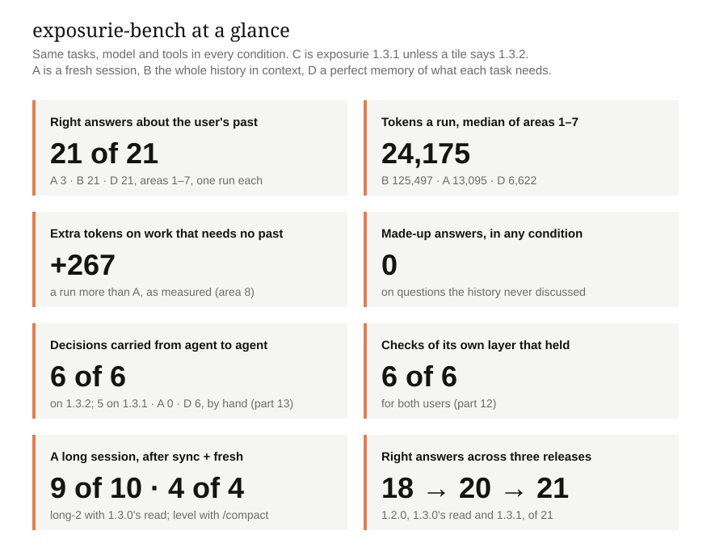
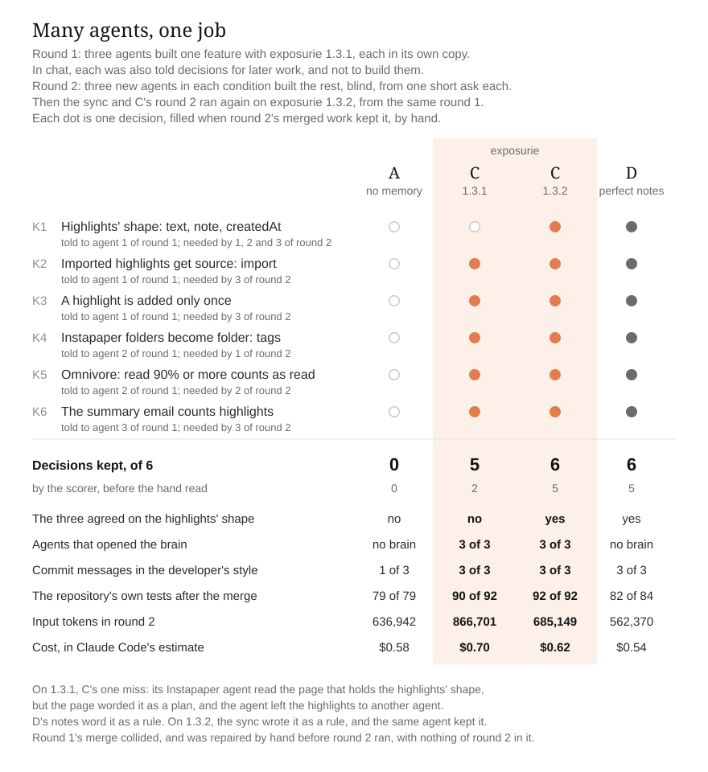
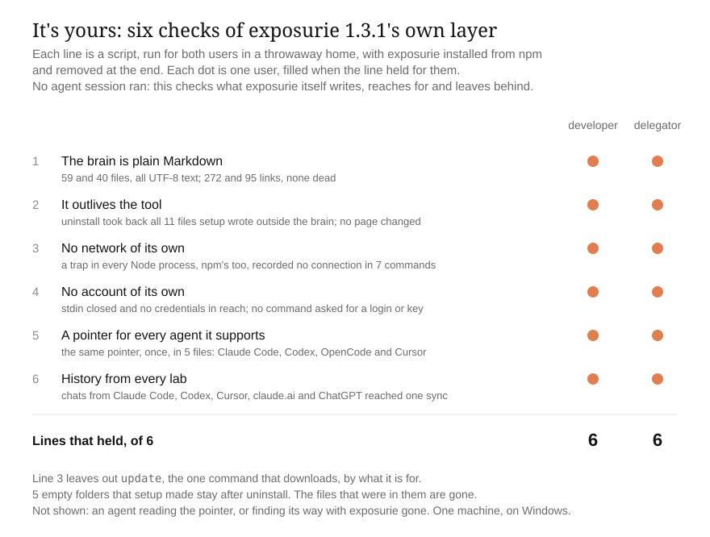
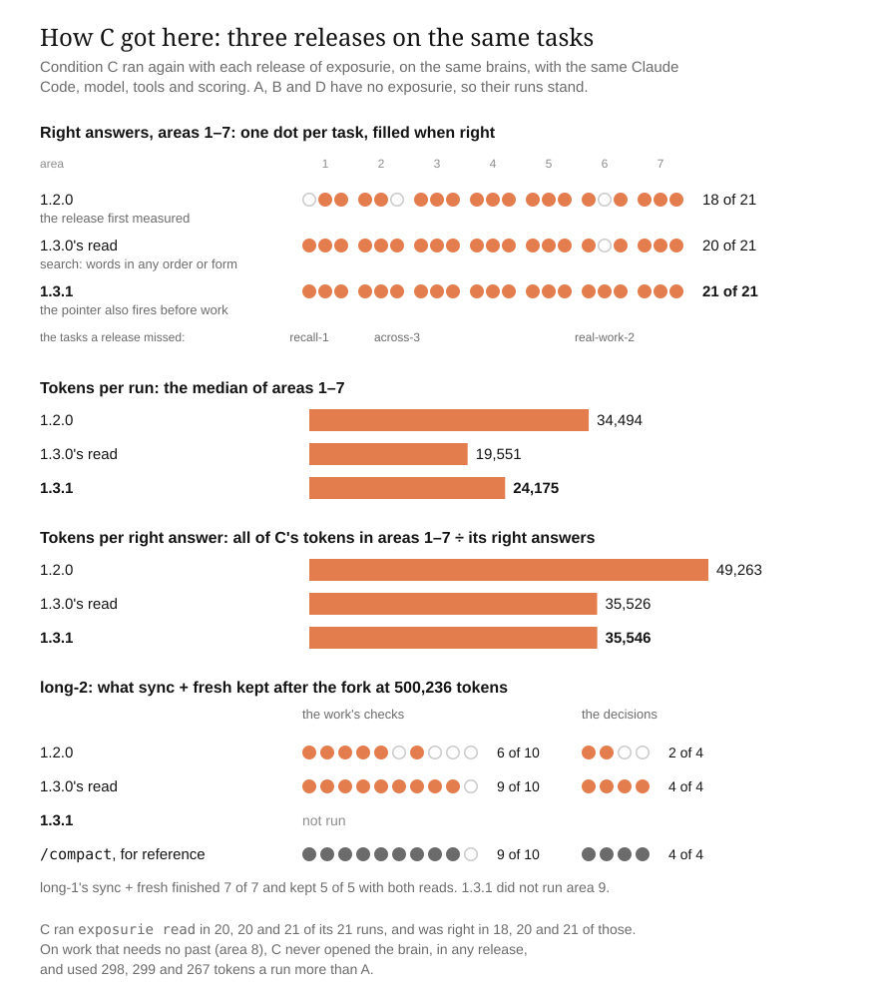

# exposurie-bench

**Does a brain built from your own past sessions make a coding agent better for you, and what does it cost?** This repository measures that for [exposurie](https://github.com/sekhonlabs/exposurie), a CLI that builds a curated Markdown wiki, the *brain*, from a person's own agent sessions and chat exports, and points every new agent session at it.

**Status: finished.** Every result is final, every answer a script could not settle was read by hand, and every number and chart is computed from [results/](results/) by [score/results.mjs](score/results.mjs). The results lead with exposurie **1.3.1**, the version on npm.

## In one minute

- **It knows you.** On 21 questions and tasks about a user's past, a fresh agent session with exposurie got **21 right**. The same session without it got 3, all of them cases where the right answer was that nothing was recorded. [More](#1-it-knows-you-areas-1-to-8)
- **For a fraction of the tokens of carrying your history.** A median of **24,175** input tokens a run, against 125,497 for putting the whole history in context, which also got 21 right. [More](#1-it-knows-you-areas-1-to-8)
- **Almost free when no past is needed.** On work that needs no past it never opened the brain, and used **267 tokens a run** more than a fresh session as measured, about 313 like for like. [More](#1-it-knows-you-areas-1-to-8)
- **It does not make things up.** No made-up answers, in any condition.
- **It carries decisions from agent to agent.** When one job was split across agents that never saw each other, exposurie carried **5 of 6** decisions from the first round into the second. With no memory it was 0, and with a perfect hand-written notes file 6. [More](#2-many-agents-one-job-part-13)
- **It stays yours.** **6 of 6** checks of exposurie's own layer held: plain Markdown, it outlives the tool, no network or account of its own, a pointer for every agent it supports, and history from every lab. [More](#3-its-yours-part-12)
- **A long session can carry on from the brain.** Past 500,000 tokens, ending the session, syncing it and starting fresh kept as much as `/compact` did on the harder task, for about a quarter of the tokens of keeping going. [More](#4-long-sessions-area-9)
- **Each fix was measured.** C went from 18 to 20 to 21 right across three releases, each one fixing a miss this benchmark found. [More](#5-how-c-got-here-three-releases)

Every result has its limits, gathered in [What this does not show](#what-this-does-not-show).

## How it works

Two made-up users, so every right answer is known and nothing private is published:

- **The developer:** a backend engineer with long, precise prompts. 28 sessions, at work and on their own projects.
- **The delegator:** not a developer, hands everything to agents in 3 to 10 words. 15 Claude Code sessions and 10 claude.ai chats.

Their 53 sessions were generated from [planted facts](users/), each one a non-default choice a fresh agent cannot guess, and exposurie built a brain from each user's history. Then the same tasks ran in four conditions, with the same model (Sonnet 5.5 on Claude Code 2.1.302) and the same tools:

| | Condition | Stands for |
|---|---|---|
| A | Fresh session | what every new session gets today |
| B | Whole history in context | the long-session habit, or pasting history back in |
| **C** | **exposurie** | **a fresh session, exposurie's pointer, the brain and the `exposurie` command** |
| D | Perfect memory | only the facts the task needs, pasted in |

The tasks cover nine areas, three tasks each and two in the last: 1 recall, 2 across projects, 3 changed decisions, 4 never discussed, 5 your way, 6 real work, 7 chat to agent, 8 no past needed, and 9 long sessions. Part 13 then gives one job to several agents, and part 12 checks that the brain stays its person's.

**What keeps it honest:** a sandbox with its own pinned Node, Git, Claude Code and exposurie, with no remote flags and no connectors; blind run folders, with which run had which condition published only once every verdict was final; every tool call audited, and any run that reached outside its folder thrown out; and a usage-limit stop counts as "not run", never "wrong". Tokens are every input token the model read, cached or not. Output is small and alike in every condition, so it is counted apart. The full method is in [docs/design.md](docs/design.md).

## Results

### 1. It knows you: areas 1 to 8

- **Right answers, areas 1 to 7, of 21:** A 3, B 21, **C 21**, D 21. All three of A's are in area 4, where the right answer is that nothing was recorded.
- **Looked, and found:** C ran `exposurie read` in all 21 runs of areas 1 to 7, and was right in all 21. None of area 8's three opened the brain: they are work that needs no past, in an empty folder.
- **Made-up answers** (area 4): none, in any condition.
- **Changed decisions** (area 3) under C were right every time: 3 of 3 here, and 9 of 9 with each earlier release.

- **Tokens per run,** median of areas 1 to 7: A 13,095, B 125,497, **C 24,175**, D 6,622. C used about 13% of B's tokens on a question (16,796 against 125,495), and about 10% on a work task (76,063 against 736,844).
- **Tokens per right answer:** A 126,197, B 277,950, **C 35,546**, D 17,675.
- **On work that needs no past** (area 8), C used 267 tokens a run more than A as measured. Like for like it is about 313: 1.2.0's 298, plus about 15 for 1.3.1's longer pointer. The measured number is lower because the sandbox's Claude Code rewrote its own state file during this batch, so every later run started 46 tokens smaller than A's runs. B used 125,509, because it carries the whole history every time.

Which runs these are, and how C was set up

C's 24 runs are `full-3`, one for each task of areas 1 to 8, run on 2026-11-05 with exposurie 1.3.1. A's, B's and D's are the full run's of 2026-10-21, one run per task and condition. They have no exposurie, so they stand. Of C's 24 verdicts, 13 were settled by a task's checks and 11 by the judge and then by hand, and the hand read overturned none. Output was a median of 439 to 658 tokens a run in every condition. The numbers are in [results/numbers.json](results/numbers.json), under `pointer_for_work`.

Before each C run, two things were set up the same way, and [docs/decisions.md](docs/decisions.md#2026-11-05) gives the reasons:

- **The run's home was brought up to 1.3.1 by exposurie's own update step.** The brains were set up by 1.2.0, and the first 1.3.1 command on such a machine rewrites the pointer, skill and command exposurie wrote outside the brain. The brain itself is not touched. This is what a person who updates from 1.2.0 has after their first command.
- **The run's copy of the brain was made 3 days old,** so exposurie's state line read `last sync 3d ago`, with no line asking the agent to sync. The brains were last synced on 2026-10-21. Every page is the same.

**Against what [design.md](docs/design.md#what-we-expect-written-before-the-results) expected before any result:** C beat A by a wide margin, and used more raw tokens than A (24,175 against 13,095 a run). B was expected to be more accurate than C with a history this short: with 1.2.0 it was, 21 against 18, and with 1.3.1 C matches it. Changed decisions lost no detail: area 3 under C was right in every run of every release.

**Dropped on 2026-10-28** (see [decisions.md](docs/decisions.md#2026-10-28)):

- *Potential reached*, (C − A) ÷ (D − A). It only restated the right-answer count, since B and D got every answer right.
- *Break-even*, the sessions until a brain's build tokens are saved back against B. Its answer swung tenfold with the unit (for the developer's questions, 44 sessions in input tokens and 4 in list-price dollars), and a brain is built on a plan its owner already pays for. Each build's tokens stay in [results/builds.json](results/builds.json).

### 2. Many agents, one job (part 13)

Someone running several agents in parallel on one job, with the brain as their shared memory. While agents work side by side, none hears what the others are told.

**By hand, round 2's merged work kept 0 of round 1's 6 decisions with no memory, 5 with exposurie 1.3.1, and 6 with a perfect notes file.**

- **Round 1:** three agents built the import of Satchel, the developer's own app, in condition C, each in its own copy of the code: the job, a Pocket reader, and the import page with its summary email. In conversation, each was also told decisions for the work that came next, and not to build them. Their copies were merged with Git's union merge, tested, and synced into the developer's brain.
- **The sync filed all six decisions,** into a page of their own. Round 1 wrote none of them into its code, so in round 2 they existed only in the brain, or in D's notes.
- **Round 2:** three new agents in each condition built Instapaper's reader, Omnivore's reader and imported highlights, blind, from one short ask each. Each needed decisions told to two different agents of round 1, and the highlights' shape was needed by all three. The conditions differ only in what carried round 1's conversations into round 2.
- **C's one miss was not the brain's.** Its Instapaper agent searched the brain, read the page that holds the highlights' shape, and left Instapaper's highlights out: "Highlights belong to the other agent's side." Its ask gave the third agent "the highlights side", and the page words that decision as a plan ("readers will put highlights"). D's notes word it as a rule, and D's Instapaper agent followed it. The brain carried every decision; its wording decided whether one was acted on.
- **Round 1's merge collided.** The job agent and the page agent both wrote the upload route, and both added a test file of the same name, so the union merge declared everything twice and the code did not load. It was repaired by hand, 9 lines in and 41 out, with nothing of round 2 in it: [results/team-1/repair-1.patch](results/team-1/repair-1.patch). That is a finding about parallel agents, not about exposurie.

The hand read, the cost, and where everything is

The hand read overturned the scorer where the scorer was wrong, in four ways, each recorded in [hand.json](results/team-1/hand.json) and resting on hand tests published beside it, [hand.test.js](results/team-1/hand.test.js):

- a hidden test expected more than its decision said
- a check missed a threshold written as a named constant
- two tests could reach the third agent's code only through Instapaper's export
- a check found a commit prefix anywhere in the last reply

**The user's way:** SQL stayed in `.sql` files in all nine runs. A's commit messages said what, not why, in two of three; C's and D's all gave a reason, C's taken from round 1's decisions in the brain.

**Cost:** about $3.26 in Claude Code's estimates at list prices: $1.14 for round 1, $0.29 for the sync, and $0.58, $0.70 and $0.54 for round 2 in A, C and D. The plan's seven-day meter read 5% after the first step and 9% after the last run.

The design is in [docs/build-plan.md](docs/build-plan.md), part 13. The scores, which run had which condition, the hand read with a reason for every verdict, and round 1's repair are in [results/team-1/](results/team-1/), and the numbers in [results/numbers.json](results/numbers.json) under `many_agents`.

### 3. It's yours (part 12)

A brain belongs to its person, and stays theirs when they change agent or lab. exposurie is a layer for the user's agent: the agent reads its pointer, runs its commands and writes the pages, on the user's own plan with its lab. These six lines run exposurie's commands directly, without an agent session, so they check exposurie's own layer: what it writes, what it reaches for, what it collects and what it leaves behind. They do not stand in for the agent, which the results above measured.

**6 of 6 lines held, for both users.** Each user's check ran in a throwaway home holding a copy of their brain, with exposurie 1.3.1 installed from npm's tarball at the start and uninstalled at the end.

What each line checked

1. **Plain Markdown.** Every file in the two brains outside git's own folder is UTF-8 text: 59 and 40 files. Their 41 and 22 pages hold 272 and 95 links, and every one leads to a file in the same brain. They were read with exposurie uninstalled.
2. **It outlives the tool.** Setup wrote 11 files outside the brain: the pointer into five instructions files, a skill for two agents, a slash command for three, and its config. Uninstall took every one back. The user's own files came back byte for byte, every file in the brain was unchanged, no page changed from install to uninstall, and npm's copy of the package was removed. Five folders setup made for those files stay behind, empty, such as `~/.claude/skills/`.
3. **No network of its own.** Every command ran with a trap loaded into Node that blocks and records any connection or name lookup, npm's too when uninstall runs it. It recorded none. A control showed it catches 12 ways out, from CommonJS and from ES modules. exposurie's code loads no network module. It runs npm in two places: uninstall removes the package, and `update` installs a new release. `update` is the one command that downloads, by what it is for, and is left out.
4. **No account of its own.** Every command ran with stdin closed and no credentials in its environment, and finished: `init` and `scaffold` with 10, exposurie's code for a step left to the person, and the rest with 0. Nothing asked for a login, a key or a sign-up, the code reads no credential from its environment, and it never waits on a person.
5. **A pointer for every agent it supports.** In a home with Claude Code's, Codex's, Cursor's and OpenCode's folders, setup wrote the same pointer, with 1.3.1's line for work, once into each: `~/.claude/CLAUDE.md`, `~/.codex/AGENTS.md`, OpenCode's `AGENTS.md` in both its places, and a rules file of its own in `~/.cursor/rules/`. The user's own lines stayed where they were, above it.
6. **History from every lab.** A made-up chat in Claude Code's, Codex's and Cursor's stores and in a claude.ai and a ChatGPT export, each with a code found nowhere else, all reached one sync's batch, for both users. exposurie says what it does not read: "opencode, Gemini CLI, Windsurf and Aider are not read." So OpenCode gets the pointer but its history is not read, and Gemini CLI gets neither.

Each line's evidence, and each command's output for each user, are in [results/its-yours/](results/its-yours/). A fault test broke each line's check, 33 ways, and every break was caught, one of them by running the control with the trap left out.

### 4. Long sessions (area 9)

A common rule of thumb says to start a fresh session at half the context window, with the brain synced first. Area 9 tests it with two long tasks of the developer's. Each is one session, filled live to the first step past 500,000 tokens of Sonnet 5.5's 1,000,000, then carried on three ways from that same point, each given the same remaining steps:

- **keep going** in the same session
- **`/compact`**, Claude Code's own summary
- **sync + fresh:** end the session, sync it into the brain from another session five minutes later, and start a fresh one

- **keep going and `/compact` lost almost nothing.** Across both tasks, keep going held all 17 checks of the work and all 9 of the decisions. `/compact` held 16 and 9: its one miss was long-2's deploy note, which never named the team's deploys channel.
- **With 1.2.0, sync + fresh was exactly as good as the brain's search.** In long-1 it finished 7 of 7 and kept 5 of 5. In long-2 it finished 6 of 10 and kept 2 of 4. The brain held every rule it lost, but the fresh session searched with whole phrases, and 1.2.0's search matched a whole phrase as one substring, so it found no page.
- **With 1.3.0's read, long-2's sync + fresh is level with `/compact`:** 9 of 10 finished and 4 of 4 kept.
- **No strategy retried an approach that had already failed:** 0 of 6 each.
- **keep going took 3 to 6 times the tokens,** because every call re-reads the whole session: 10,935,771 and 8,100,651 after the fork, against 1,808,849 and 1,717,031 for `/compact` and 2,488,613 and 2,532,829 for sync + fresh. In money the gap is smaller, because a cache read costs a twentieth of an uncached input token.

The two tasks, tokens and dollars, and how it was scored

- **long-1** is the developer's own app, Satchel: imports from Pocket, Instapaper and Omnivore. It forked after step 19, at 509,677 tokens.
- **long-2** is their work's API, tidewell-api: webhooks for project events, under one ticket, through an on-call week. It forked after step 24, at 500,236 tokens. The team's conventions for a pull request are never said in the session, so a strategy keeps them only by looking them up.

**What 1.2.0's sync + fresh lost in long-2:** both decisions said only in the conversation (it put replaying a dead letter on the customer's own key, where the rule was the staff-only admin routes, and made up its own retention, 14 and 30 days, where the rule was 45), and four of the team's five conventions: the branch format, the four sections, the note for the migration's reviewer, and the deploy note. The sync had filed the session's rules into a page of their own, and other pages held the team's conventions. It is the same flaw as across-3's miss in areas 1 to 7, where a plural never found its singular.

**A decision "said only in the conversation"** is one that nothing in the code at the fork shows, so a fresh session can only get it from the brain.

**Tokens** are every input token after the fork. The totals include the `/compact` call itself (511,672 and 502,231, one read of the session) and the sync session (976,651 and 1,105,841). So keep going used 6.0 and 4.7 times `/compact`'s tokens, and 4.4 and 3.2 times those of sync + fresh.

**Dollars**, in Claude Code's own estimates at list prices: long-2 ran with its cache warm throughout, and its three strategies came to $1.68, $0.95 and $1.41. long-1 ran through two usage-limit stops, which let the cache expire, so keep going's first two steps and the `/compact` call each wrote the whole session into it again, and keep going came to $6.06. Both tasks together cost $30.67.

**Stopped attempts:** after the forks, a usage limit stopped two attempts, both in long-1's keep going. Each ran again from the same point, so their 4,263,340 tokens are counted apart.

**Scoring:** area 9 cannot be scored blind, because a stream shows which strategy made it. Every strategy was read by hand, and a verdict there overrides the scripts. The scores, the hand read with a reason for each verdict, and every step's record are in [results/area-9/](results/area-9/), and the numbers in [results/numbers.json](results/numbers.json) under `area_9`.

**Against what [design.md](docs/design.md#what-we-expect-written-before-the-results) expected before any result:** `/compact` beat sync + fresh within a single task, as expected. Long sessions were expected to be where curation loses detail. Here it was retrieval that lost it: the brain held every rule, and the fresh session lost the ones its search did not find.

### 5. How C got here: three releases

C ran three times on the same brains, with the same Claude Code, model, tools, audit and scoring, each time with a newer exposurie. A, B and D have no exposurie, so their runs stand.

- **1.2.0** (2026-10-21) missed three. recall-1 gave the wrong reasons; across-3 searched for "google sheets" where the page says "Google Sheet", and 1.2.0's search matched a whole phrase as one substring; real-work-2 never opened the brain.
- **1.3.0's read** (2026-10-25) rebuilt the search to take words in any order and any form, rank the pages, and print the best ones whole: 20 of 21. The one miss left was real-work-2, whose agent never looked.
- **1.3.1** (2026-11-05) added one condition to the pointer: read the brain before starting work in one of the user's projects, as well as before answering a question about them. 21 of 21, and the new line fired on the user's work and not on other work.

Each release in detail

**1.2.0 (2026-10-21).** The published `@sekhon/exposurie` 1.2.0. All 93 runs of areas 1 to 8 ran in one mixed order, then the stability check's 6. Of the full run's 93, 54 verdicts were settled by a task's checks and 39 by hand, every answer the judge decided among them. Its numbers are at the top level of [results/numbers.json](results/numbers.json). C's three wrong answers, each named by its run in [results/full/](results/full/):

- **recall-1** (`r049`) named SQLite, with the wrong reasons. The pilot's C run, on the same brain, gave the right ones.
- **across-3** (`r009`) searched for "google sheets", "sheets" and "spreadsheet", and named only the spending summary. The brain's page on the book club speaks of a "member Google Sheet", in the singular.
- **real-work-2** (`r003`) never ran `exposurie read`. Its pull request missed the team's branch format, `ENG-431-slug`, and its four sections.

**1.3.0's read (2026-10-25).** exposurie's `read` was rebuilt at commit [`b6855ee`](https://github.com/sekhonlabs/exposurie/commit/b6855ee30d876bb3f109088ccabb85450a0b2234). Its records say `1.2.0+b6855ee`, because its package still said 1.2.0 when it ran. npm has served the same search, read and pointer as **1.3.0** since 2026-11-04, byte for byte, so this README and the charts call it 1.3.0's read. 1.3.0 also adds `exposurie update`, which these runs never saw, so the records keep the label they recorded ([decisions.md](docs/decisions.md#2026-11-05)). What exposurie installs was the same text in both versions, so this C differs from 1.2.0's by the `exposurie` command alone. It ran as `full-2` (the 24 C runs of areas 1 to 8), `stability-3` and `stability-4` (area 3 under C, twice more), and `area-9-2` (sync + fresh's fresh session again in each long task, from the same fork and against the very brain its sync wrote). The hand read overturned none of the 17 judged answers. The numbers are under `rebuilt_read`.

- recall-1 gave the recorded reason for SQLite (one file on one machine, with Litestream for backups), and across-3 named both projects on a Google Sheet.
- real-work-2 (`r011` in [results/full-2/](results/full-2/)) again never ran `exposurie read`, so the miss is the pointer's, not the search's.
- Questions got cheaper and work tasks dearer. A search now prints the best pages whole, so a run that looked made a median of 1.5 reads, against 5. A question's median run fell from 30,089 tokens to 16,665, and a work task's rose from 69,939 to 81,092.
- long-2's fresh session searched for `ENG-447 webhooks project events`, found 34 pages, and read the one its sync had written. It kept both decisions said only in the conversation and four of the team's five conventions, where 1.2.0's kept one. It missed the deploy note's channel, as `/compact` did: the page that holds it matched only two of the search's eight words, and was not among the 14 of 39 pages shown. With the sync session included, long-2's sync + fresh took 2,167,372 tokens ($1.31) and long-1's 2,822,510 ($1.49), since its fresh session read more of the brain.

**1.3.1 (2026-11-05).** On npm from commit [`64eb3f8`](https://github.com/sekhonlabs/exposurie/commit/64eb3f8c3a1d7686f14915c0f5f542ccd38e0a56), it adds to the pointer: run `exposurie read --search "<topic or project>"` *before starting work in one of their projects*. Its search and read are 1.3.0's. Its runs are `full-3`, set up as [section 1](#1-it-knows-you-areas-1-to-8) describes.

- real-work-2 (`r015` in [results/full-3/](results/full-3/)) ran `exposurie read` before starting, and its PR.md gives the branch as `ENG-431-export-empty-org`, a title that opens with the ticket key, and the team's four sections: why, what changed, how it was tested, and how to roll it back.
- The cost per right answer is level, with one more right answer: 35,546 tokens against 35,526. The median over areas 1 to 7 rose to 24,175 because two questions, across-2 and your-way-2, read a second page and moved past the middle of the 21 runs. Both were right before and are right now.
- The measurement cost $1.00 in Claude Code's estimates at list prices: $0.93 for the runs and $0.07 for the judge.

## What this does not show

- **One run per cell,** so a count per area is only indicative.
- **One agent and one model:** Claude Code with Sonnet 5.5.
- **Two made-up users,** with histories small enough for B to fit in context, which a real history would not.
- **The fixes were measured on the tasks that found them.** 1.3.0's search and 1.3.1's pointer were each made after a miss on these same tasks, so these tasks show that those misses are fixed. Part 13's tasks did not shape them, and test them more fairly.
- **Part 13:** one job and one user; round 1 ran once, in C, and was repaired by hand; the agents could not run tests, which ran after each merge; one sync, so exposurie's missing lock, where two syncs at once take the same batch, never came up; and the decisions were written for this test.
- **Part 12:** no agent session ran, so it does not show an agent reading the pointer, or finding its way in a brain once exposurie is gone; one machine, on Windows; and the chats were written from exposurie's own readers, so they show each reader reads the format it was written for, not every export a lab has shipped.
- **Area 9:** two tasks and one user, with one run of each strategy, so it is an illustration, not a rate. The sessions ended at about 580,000 tokens, too close to the mark to test whether quality falls past half the window. 1.3.1 did not run it.

More in [design.md](docs/design.md#limits).

## What is in this repository

Read top to bottom, the folders are the pipeline: two users, their sessions, the tasks, the runs in four conditions, the scores, the checks, and what was published. Each folder has a README of its own.

| Folder | What it holds |
|---|---|
| [users/](users/) | the two made-up users: every planted fact, each session's brief, and the sessions themselves |
| [gen/](gen/) | the generator that writes each session from its brief, and the converter that turns them into agent transcripts and a claude.ai export |
| [tasks/](tasks/) | every task with its checks and the judge's rubric, the starter projects, what B and D are given, the long sessions and the team task |
| [runner/](runner/) | the sandbox, the runner and the brain build, the long sessions, the team task, part 12's checks, and the fake `claude` they are all tested against |
| [score/](score/) | how a run is scored, the judge, and every number and chart |
| [check/](check/) | one check per part, holding it to the method |
| [results/](results/) | every published score, hand read, number and chart; its README says which folder is which |
| [docs/](docs/) | the method, the build plan, every decision and every source |

| To read | Open |
|---|---|
| the method, fixed before anything ran | [docs/design.md](docs/design.md) |
| the order it was built in, part by part | [docs/build-plan.md](docs/build-plan.md) |
| every decision, dated, and why | [docs/decisions.md](docs/decisions.md) |
| the papers and docs it builds on | [docs/sources.md](docs/sources.md) |
| the rules for any agent working here | [CLAUDE.md](CLAUDE.md) |

## Check it yourself

On Windows, for now. Clone it into a folder of its own, such as `exposurie-bench/repo`: the sandbox and the raw runs sit beside the repository, never inside it.

1. `powershell -NoProfile -ExecutionPolicy Bypass -File runner\bootstrap.ps1` puts the sandbox's pinned Node beside the repository, then installs the pinned Git, Claude Code and exposurie ([runner/pins.json](runner/pins.json)).
2. `..\sandbox\node\node.exe score\results.mjs` prints every number, computed again from `results/` alone, and `..\sandbox\node\node.exe check\results.mjs` checks that `results/`, its charts and this README's headlines are exactly what that computes.
3. Running the tasks again needs a Claude plan login in the sandbox (`runner/sandbox.mjs login`), never an API key, and spends plan usage. [docs/build-plan.md](docs/build-plan.md) gives each part's commands.

## License

MIT
